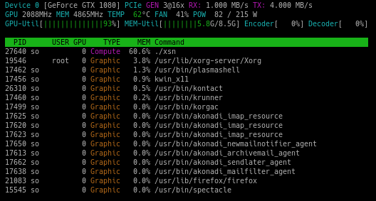
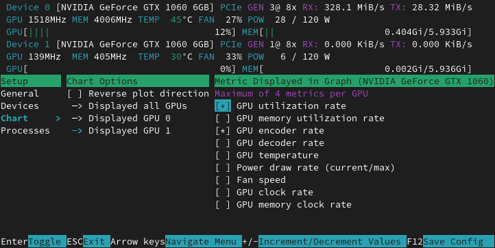

# NVTOP

NVTOP stands for Neat Videocard TOP, a GPU and accelerator task monitor with an
interface similar to htop. It displays utilization, memory, temperature, power,
and running processes for multiple devices.

NVTOP supports AMD, Apple, Huawei Ascend, Intel, NVIDIA, Qualcomm Adreno,
Broadcom VideoCore, Rockchip, MetaX, Enflame, Tenstorrent, Iluvatar CoreX,
T-Head PPU, and Intel Gaudi devices. Available metrics depend on your hardware,
driver, and operating system.



## Table of Contents

- [Installation](#installation)
  - [Ubuntu / Debian](#ubuntu--debian)
  - [Fedora / Red Hat / CentOS](#fedora--red-hat--centos)
  - [OpenSUSE](#opensuse)
  - [Arch Linux](#arch-linux)
  - [Gentoo](#gentoo)
  - [AppImage](#appimage)
  - [Snap](#snap)
  - [Conda-forge](#conda-forge)
  - [Pixi](#pixi)
  - [Docker](#docker)
  - [WSL2](#wsl2)
- [Using NVTOP](#using-nvtop)
- [GPU and Accelerator Support](#gpu-and-accelerator-support)
- [Building from Source](#building-from-source)
- [Troubleshooting](#troubleshooting)
- [License](#license)

## Installation

Install NVTOP with your package manager, use an [AppImage](#appimage) or
[Snap](#snap), or [build from source](#building-from-source).

### Ubuntu / Debian

On Ubuntu 22.04, Debian 11, and newer:

```bash
sudo apt install nvtop
```

A [PPA for Ubuntu 22.04 and newer](https://launchpad.net/~quentiumyt/+archive/ubuntu/nvtop),
maintained by [Quentin Lienhardt](https://github.com/QuentiumYT), provides NVTOP
with NVIDIA, AMD, and Intel support:

```bash
sudo add-apt-repository ppa:quentiumyt/nvtop
sudo apt install nvtop
```

### Fedora / Red Hat / CentOS

On Fedora 43 and newer:

```bash
sudo dnf install nvtop
```

On Red Hat Enterprise Linux 8, 9, and 10, enable EPEL first:

```bash
sudo dnf install -y https://dl.fedoraproject.org/pub/epel/epel-release-latest-$(rpm -E %{rhel}).noarch.rpm
sudo dnf install nvtop
```

On CentOS Stream, Rocky Linux, and AlmaLinux:

```bash
sudo dnf install -y epel-release
sudo dnf install nvtop
```

### OpenSUSE

On OpenSUSE 16.0 and newer:

```bash
sudo zypper install nvtop
```

### Arch Linux

```bash
sudo pacman -S nvtop
```

### Gentoo

```bash
sudo emerge -av nvtop
```

### AppImage

Download the AppImage for your architecture (`x86_64` or `aarch64`) from the
[release page](https://github.com/Syllo/nvtop/releases/latest). Make the downloaded
file executable and run it, replacing the filename below with yours:

```bash
cd "$HOME/Downloads"
chmod u+x "nvtop-<version>-<arch>.AppImage"
./"nvtop-<version>-<arch>.AppImage"
```

The AppImage requires glibc 2.28 or newer (for example, Ubuntu 20.04+, Debian 10+,
or RHEL 8+) and your GPU drivers installed on the host.

### Snap

Install the Snap and connect the permissions for the features you need:

```bash
snap install nvtop
# Allow terminating processes from NVTOP
snap connect nvtop:process-control
# Allow reading hardware information such as fan speed and power
snap connect nvtop:hardware-observe
# Allow listing AMD GPU processes
snap connect nvtop:system-observe
# Workaround for per-process GPU usage
snap connect nvtop:kubernetes-support
```

### Conda-forge

```bash
conda install --channel conda-forge nvtop
```

The package is maintained in the [conda-forge feedstock](https://github.com/conda-forge/nvtop-feedstock).

### Pixi

```bash
pixi global install nvtop
```

### Docker

For NVIDIA GPUs, install the NVIDIA drivers and
[NVIDIA Container Toolkit](https://docs.nvidia.com/datacenter/cloud-native/container-toolkit/install-guide.html#docker),
then build and run the container:

```bash
git clone https://github.com/Syllo/nvtop.git
cd nvtop
sudo docker build --tag nvtop .
sudo docker run -it --rm --runtime=nvidia --gpus=all --pid=host nvtop
```

`--pid=host` makes host GPU processes visible to NVTOP.

### WSL2

Support in WSL2 depends on your GPU vendor. For NVIDIA, follow
[NVIDIA's CUDA on WSL2 guide](https://docs.nvidia.com/cuda/wsl-user-guide/index.html#getting-started-with-cuda-on-wsl).
Use the driver provided by Windows; installing NVIDIA Linux drivers inside
WSL2 can cause driver version mismatches.

## Using NVTOP

Start the interactive monitor with:

```bash
nvtop
```

Use these keys to control the interface:

| Key | Action |
| --- | --- |
| `F2` | Open setup to choose devices, charts, and display options |
| `F6` | Change the process sort order |
| `F9` | Send a signal to the selected process |
| `F12` | Save preferences for future runs |
| `F10`, `q`, or `Esc` | Quit |

In setup, the **Devices** section chooses which GPU temperature is shown and
plotted: the hotspot (the hottest point of the die, the default) or the edge
sensor. A GPU that reports only one of them shows that one. The same section
configures the utilization bars and the memory display. The **Chart** section
selects the plotted metrics, such as utilization, temperature, power, clocks,
and PCIe RX / TX load (throughput as a percentage of the link bandwidth).

Utilization bars are green, turn yellow from 75% and red from 90%; effective
load is shown in cyan. The yellow and red levels can be moved or disabled, and
the effective load overlay hidden, in the **Devices** section.

Charts are drawn with Unicode braille dots by default, with each metric in its
own color. For the original appearance, disable **Finer plot lines** or
**Graphical utilization bars** in setup, or use `--legacy-plot` and
`--legacy-bars` on the command line. NVTOP switches to the legacy style
automatically when the locale is not UTF-8, on the Linux console, or when it
was built without wide-character ncurses. The legacy bars are also used with
`--no-color` or on terminals with fewer than 8 colors.

Preferences saved with `F12` are stored in `$XDG_CONFIG_HOME/nvtop/interface.ini`
(usually `~/.config/nvtop/interface.ini`); use `-c` to choose another file.



For command-line help and the full manual:

```bash
nvtop --help
man nvtop
```

For scripting, `nvtop --snapshot` (`-s`) prints a JSON snapshot and
`nvtop --loop` (`-l`) prints snapshots repeatedly. Snapshots report both GPU
temperatures, as `temp` and `hotspot_temp`.

### Reading the Display

Devices without memory of their own (integrated GPUs and NPUs, and
unified-memory systems such as DGX Spark) share the system memory with the
host. For them, `MEM` shows:

- **used**: the memory processes have allocated for this device only;
- **total**: that amount plus the system memory still available for new
  allocations, capped at the total system memory.

The total therefore shrinks when the CPU or other programs use more memory.
Buffers shared between processes are counted once, so the used amount is a
lower bound. If device allocations cannot be read, NVTOP shows system memory
usage instead, labeled `RAM`. Apple's memory display differs; see
[Apple](#apple).

To always see system RAM usage for these devices, start NVTOP with
`--system-memory` (`-M`) or enable it in setup (for all devices in the
**Devices** section, or per device in the **Chart** section). This only
changes the interactive display: snapshots always report the device memory in
`mem_*` and the system memory in `system_total_memory` and
`system_free_memory`.

`SYS-FAN` indicates that an integrated device has no fan of its own and relies
on system cooling (snapshots report `"System Fan"`). Versions up to 3.4.0 showed
`CPU-FAN` / `"CPU Fan"` instead. Metrics the hardware or driver does not
provide appear as `N/A`.

## GPU and Accelerator Support

Install the driver for your device before running NVTOP. Support for recent
hardware is regularly added to the Linux kernel, so use a kernel recent enough
for your device; the sections below list the minimum versions for each feature.
Older kernels and drivers simply show fewer metrics.

On Linux, NVTOP only sees the processes of the current user unless run as root,
so per-process data and device memory computed from it only cover that user.
When several processes share one device client (for example after `fork()`),
its usage is shown on one of them; the others are listed without metrics.

### AMD

AMD GPUs are supported through the `amdgpu` driver. Older GPUs using `radeon`
have limited metrics. Process monitoring with `amdgpu` requires Linux 5.14 or
newer.

ROCm/HIP compute work is not visible in the regular GPU usage counters. NVTOP
adds it to the process utilization when the kernel reports it, which depends on
the GPU family:

| GPU family | Minimum kernel |
| --- | --- |
| CDNA: MI100 / MI200 / MI300 | Linux 5.11 / 6.2 / 6.6 |
| RDNA 3 and RDNA 4 | Linux 7.3 |
| RDNA 1 and RDNA 2 | Linux 7.4 |
| GCN 1-4 | Not reported by the kernel |

This also requires a kernel built with ROCm support (`CONFIG_HSA_AMD`). GCN 1-4
GPUs are still monitored; only the ROCm/HIP part of process utilization is
missing.

### Intel

Intel GPUs are supported through the `i915` and `xe` drivers. Process monitoring
requires Linux 5.19 or newer.

On discrete GPUs, VRAM usage requires `CAP_PERFMON` with `i915` (and with `xe`
on older kernels). An accurate GPU frequency also requires `CAP_PERFMON`. Grant
it with `sudo setcap cap_perfmon=ep $(which nvtop)`, or run NVTOP as root.

With `xe`, discrete Arc A and B series GPUs show their memory temperature since
Linux 6.15. On Arc B series, since Linux 7.0, the GPU and memory temperatures
turn yellow and red as they near their limits.

With `xe`, SR-IOV physical and virtual functions are listed as separate devices.
Their utilization requires `CAP_PERFMON` and a recent kernel. Configure virtual
functions before starting NVTOP; changing their number while monitoring causes
NVTOP to exit. Monitoring keeps these devices from entering their deepest idle
power state; deselect them in setup to allow that state.

### Intel NPU

Intel NPUs on Meteor Lake, Arrow Lake, Lunar Lake, Panther Lake, Wildcat Lake
and Nova Lake are supported through the in-kernel `intel_vpu` driver. No extra
library is needed.

| Metric | Minimum kernel |
| --- | --- |
| NPU utilization | Linux 6.11 |
| Current and maximum frequency | Linux 6.15 |
| Per-process NPU memory | Linux 6.19 |

Utilization and frequency are device-wide: the driver does not report
per-process utilization, nor the NPU temperature. Keep the refresh interval at
one second or more (the interactive default) for accurate utilization.

Listing processes requires access to `/dev/accel/accelN`, which usually means
membership in the `render` group. Without it, or on kernels before 6.19, the
NPU metrics are still shown but the memory row shows system `RAM` usage.

### AMD NPU

Ryzen AI NPUs (Phoenix, Hawk Point, Strix, Krackan, Strix Halo and their
successors) are supported through the in-kernel `amdxdna` driver. No extra
library is needed.

The NPU only appears when `/dev/accel/accelN` can be opened (usually through
membership in the `render` group). The processes using it are listed with the
NPU memory they hold. NPU utilization, per process and for the device, requires
Linux 7.4 or newer; earlier kernels show `N/A`. Frequency, temperature, and
power are not reported.

### NVIDIA

NVIDIA GPUs require the NVML library provided by the NVIDIA driver. GPUs from
the Kepler generation onward are generally supported; see the
[NVML documentation](http://docs.nvidia.com/deploy/nvml-api/nvml-api-reference.html#nvml-api-reference)
for compatibility details.

GPUs that report their memory temperature (datacenter GPUs) show it after the
memory clock, as in `MEM 1215MHz  38°C`. It turns yellow within 5°C of the
memory's maximum operating temperature and red past it, as the GPU temperature
does with its slowdown temperature.

The hotspot temperature requires a driver providing NVML 13.4 or newer; older
drivers report the usual GPU temperature only.

Unified-memory systems such as DGX Spark (GB10) and RTX Spark N1X are supported.
Their memory display follows the [shared-memory behavior](#reading-the-display)
described above; in containers, make host processes visible (for example with
`--pid=host`) for complete accounting. A GPU attached through NVLink-C2C shows
`C2C LINK <n>x` instead of the PCIe link, and no PCIe throughput.

Use `nvtop -i` for an extra info bar with clocks NVML does not report (XBAR,
SYS, NVD), or `nvtop -X` to also show static specifications (shader cores, L2
cache, engines) and secondary clocks. These clocks require the NvAPI library
(`libnvidia-api.so.1`) installed by recent drivers; without it the rest of the
interface is unaffected.

### Adreno

Qualcomm Adreno GPUs are supported through the `msm` driver. Process monitoring
requires Linux 6.0 or newer.

The GPU temperature is the hottest of the GPU thermal zones. It turns yellow and
red as it nears the point where the kernel starts throttling the GPU.

### Apple

Apple support on macOS is experimental, including Apple Silicon and Intel Macs
with discrete AMD GPUs. Available metrics vary by model and macOS version.
macOS builds support only the Apple backend.

- On Apple Silicon, the memory meter shows Metal allocations against total
  shared physical memory; it does not measure overall system memory pressure.
- Power, GPU clock, temperature and fan speed on Apple Silicon come from
  undocumented macOS interfaces that may change between releases; they show as
  `N/A` when unavailable. The GPU clock may be unavailable on models NVTOP has
  not been validated on. The fan is the chassis fan shared by the SoC.
- On Intel Macs with a discrete AMD GPU, temperature, power, clocks, fan speed,
  used VRAM and per-process GPU usage are reported when the driver publishes
  them.
- PCIe devices show their bus address, link generation and width, and slot name
  (for example `Slot-1` on a Mac Pro).

### Ascend

Huawei Ascend devices are supported with the DCMI library from CANN, tested on
910B3 hardware. Support is disabled by default on Linux: when building from
source, enable it with `-DASCEND_SUPPORT=ON`. For a CANN installation outside
the standard locations, also set `-DASCEND_ROOT=/path/to/Ascend`. Enabling
Ascend turns the NVIDIA, AMD, Intel, Adreno, Mali and MetaX/Iluvatar backends
off by default; re-enable any you need with their CMake options. Metrics depend
on what the installed driver supports.

Devices with HBM also show its temperature after the memory clock. The driver
reports no limit for it, so it is not colored.

### Iluvatar CoreX

Iluvatar CoreX GPUs require the ixML runtime (`libixml.so`) supplied with the
driver. NVTOP looks for it in `/usr/local/corex/lib`, `/usr/local/corex/lib64`,
and the standard library paths; for another location, add its directory to
`LD_LIBRARY_PATH`.

### T-Head PPU

T-Head (平头哥) PPUs require the HGML runtime (`libhgml.so`) from the PPU SDK,
tested on PPU-ZW810E. NVTOP looks for it in the standard library paths and in
`/usr/local/PPU_SDK`; for another location, add its library directory to
`LD_LIBRARY_PATH`.

NVTOP shows utilization, memory, clocks, temperature, power, PCIe link and
throughput, and the processes with their memory and utilization, as far as the
installed driver supports them.

### VideoCore

Broadcom VideoCore support has been tested on Raspberry Pi 4B. It includes
frequency, temperature, utilization, memory, and H.264 decoding metrics.
Outside Raspberry Pi OS, use `linux-rpi` 6.12.y or newer and ensure `/dev/vcio`
is available.

### Rockchip

Rockchip NPU support has been tested on Orange Pi 5 Plus. It provides frequency,
temperature, and utilization.

### MetaX

MetaX GPUs require the MXSML library supplied with the driver, tested on MXC500.
See the [MetaX documentation](https://developer.metax-tech.com/doc/index).

### Enflame

Enflame GCUs require the EFML library supplied with the driver. Support has been
tested on S60, L300, and L600 devices.

### Tenstorrent

Tenstorrent Blackhole, Wormhole, and Grayskull accelerators are supported through
the [tt-kmd driver](https://github.com/tenstorrent/tt-kmd), with temperature,
power, clock, fan, PCIe, and process information. No extra library is required.

### Intel Gaudi

Intel Gaudi HPUs require the HLML library supplied with the Habana driver
packages. Support has been tested on Gaudi2 HL-225 with driver 1.24. Goya
devices are also recognized but have not been validated on hardware.

NVTOP shows utilization, memory, clock, temperature, power, PCIe, and process
information.

- Some queries are slow, so values can lag by up to one refresh interval.
- Seeing the processes of other users requires running NVTOP as root.
- Process memory is the value published by the framework (for example PyTorch),
  as shown by `hl-smi`; it appears as `N/A` when the framework does not publish
  it.
- The power limit covers the main 54 V supply only; `hl-smi` also adds the
  auxiliary 12 V supply.

## Building from Source

You need CMake 3.18 or newer, a C/C++ compiler, Git, and ncurses development
packages. Use ncurses with wide-character support for finer plot lines. AMD and
Intel GPU support also use libdrm and systemd development packages.

Install the dependencies for your distribution:

**Ubuntu / Debian**

```bash
sudo apt install cmake libncurses5-dev libncursesw5-dev gcc g++ git libdrm-dev libsystemd-dev
```

**Fedora / Red Hat / CentOS**

```bash
sudo dnf install cmake ncurses-devel gcc gcc-c++ git libdrm-devel systemd-devel
```

**OpenSUSE**

```bash
sudo zypper install cmake ncurses-devel gcc gcc-c++ git libdrm-devel
```

Some vendors also need a library supplied with their driver or SDK. Libraries
marked *runtime* are loaded when NVTOP starts, so they are not needed to build:

| Vendor | Library | CMake option |
| --- | --- | --- |
| NVIDIA | NVML (runtime), optional NvAPI | `NVIDIA_SUPPORT` |
| AMD, Intel | libdrm | `AMDGPU_SUPPORT`, `INTEL_SUPPORT` |
| Ascend | DCMI from CANN | `ASCEND_SUPPORT` (off by default) |
| MetaX | MXSML | `METAX_SUPPORT` |
| Enflame | EFML | `ENFLAME_SUPPORT` |
| Iluvatar CoreX | ixML (runtime) | `IXML_SUPPORT` |
| T-Head PPU | HGML (runtime) | `PPU_SUPPORT` |
| Intel Gaudi | HLML (runtime) | `GAUDI_SUPPORT` |
| Intel NPU, AMD NPU | none | `INTEL_NPU_SUPPORT`, `AMD_NPU_SUPPORT` |

Support for each vendor is enabled by default where available and can be turned
off with `-D<OPTION>=OFF`. Then build:

```bash
git clone https://github.com/Syllo/nvtop.git
cd nvtop
cmake -S . -B build -DNVIDIA_SUPPORT=ON -DAMDGPU_SUPPORT=ON -DINTEL_SUPPORT=ON
cmake --build build
sudo cmake --install build
```

For an installation without root privileges, set an installation prefix during
configuration and omit `sudo` when installing:

```bash
cmake -S . -B build -DCMAKE_INSTALL_PREFIX="$HOME/.local"
cmake --build build
cmake --install build
```

Ensure the chosen prefix's `bin` directory is in your `PATH`.

Select a build type with `-DCMAKE_BUILD_TYPE=`: `Release` (no debug info),
`RelWithDebInfo` (with debug info), or `Debug` (warnings and sanitizers, for
development).

## Troubleshooting

- **Missing or unreadable plot characters:** Try `nvtop --legacy-plot`. When
  building from source, install ncurses with wide-character support and rebuild
  in a clean build directory.
- **`ncurses: cannot initialize terminal type`:** Ensure `$TERM` matches your
  terminal and is not `unknown`. In PuTTY, set **Terminal-type string** to
  `putty` under **Connection > Data > Terminal Details**.
- **`NO GPU to monitor.` with NVIDIA:** Ensure the NVIDIA driver and its NVML
  library (`libnvidia-ml.so.1`) are installed and available. In WSL2, use the
  Windows-provided driver as described in [WSL2](#wsl2).
- **Missing processes or metrics:** Check the driver and kernel requirements
  in [GPU and Accelerator Support](#gpu-and-accelerator-support), along with
  permissions to access the device and processes.
- **Build errors inside a Conda environment:** Try `conda deactivate` before
  running CMake.

## License

NVTOP is licensed under GPLv3 or any later version. See [COPYING](COPYING) for
the full license.
